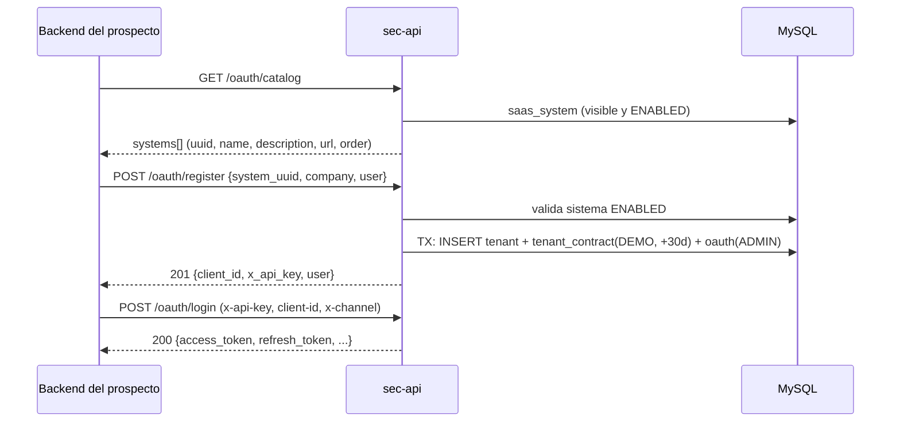
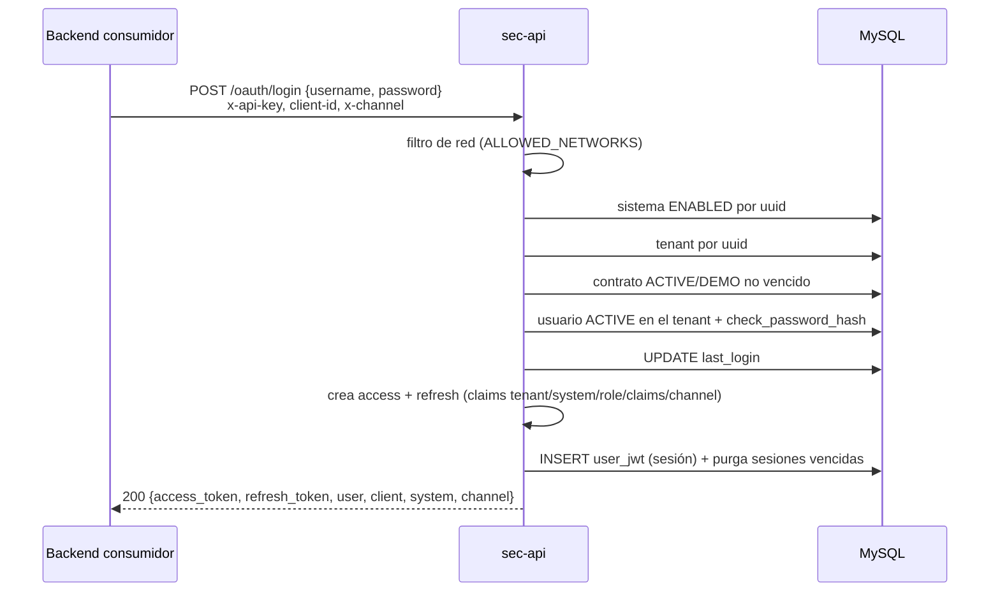
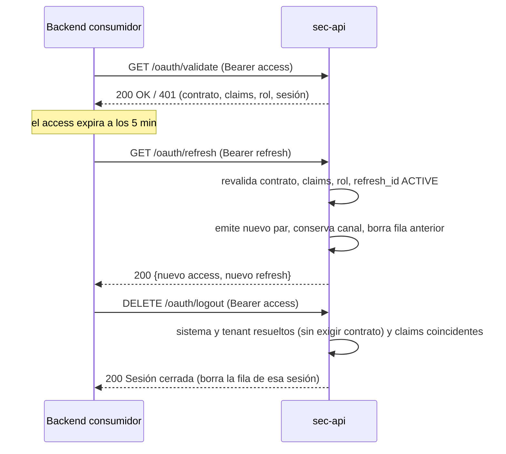

# API de Seguridad (`sec-api`) — Servidor OAuth2/JWT multi-tenant

Servidor Flask que actúa como **proveedor centralizado de autenticación** para los sistemas SaaS
de la plataforma. Gestiona:

- **Autenticación** de usuarios (usuario/contraseña) aislada por cliente (*tenant*).
- **Autorización comercial**: solo entra quien tiene un **contrato vigente** entre su empresa y el sistema.
- **Ciclo de vida de sesiones JWT** (emisión, validación, rotación, revocación, purga), con sesiones
  simultáneas **web** y **móvil**.
- **Administración** (CRUD) de sistemas, tenants, contratos y usuarios, con dos niveles de administrador.
- **Onboarding self-service**: un prospecto contrata un SaaS y recibe un contrato DEMO.

> **Modelo de tráfico: backend-a-backend.** Ningún navegador llama a esta API directamente. Cada
> front-end tiene su propio backend, y ese backend es el único cliente de `sec-api`. Todos los
> endpoints, incluido `/oauth/login`, se consideran internos.

---

## Índice

1. [Conceptos del dominio](#1-conceptos-del-dominio)
2. [Reglas de negocio](#2-reglas-de-negocio)
3. [Roles y permisos](#3-roles-y-permisos)
4. [Sesiones, tokens y canales](#4-sesiones-tokens-y-canales)
5. [Flujos](#5-flujos)
6. [Referencia de endpoints](#6-referencia-de-endpoints)
7. [Restricciones de seguridad transversales](#7-restricciones-de-seguridad-transversales)
8. [Modelo de datos](#8-modelo-de-datos)
9. [Configuración](#9-configuración)
10. [Instalación y despliegue](#10-instalación-y-despliegue)
11. [Semillas y pruebas locales](#11-semillas-y-pruebas-locales)
12. [Observaciones y limitaciones conocidas](#12-observaciones-y-limitaciones-conocidas)
13. [Solución de problemas](#13-solución-de-problemas)

---

## 1. Conceptos del dominio

| Concepto | Tabla | Identificador público | Cómo viaja | Descripción |
|---|---|---|---|---|
| **Sistema SaaS** | `saas_system` | `uuid` | Cabecera `x-api-key` | Producto que consume la autenticación (p. ej. "Portal de Firmas", "consola"). Puede estar `ENABLED` o `DISABLED`, y ser `visible` o no en el catálogo. |
| **Tenant / Cliente** | `tenant` | `uuid` (único) | Cabecera `client-id` | Empresa cliente. Los usuarios pertenecen a un tenant. |
| **Contrato** | `tenant_contract` | `id` | — | Relación tenant ↔ sistema con estado (`ACTIVE`, `DEMO`, `INACTIVE`) y fecha de término opcional (`finish_at`). **Es lo que habilita el acceso.** |
| **Usuario** | `oauth` | `username` (único **dentro** del tenant) | Body del login | Credencial, rol, `claims`, estado. El mismo `username` puede existir en varios tenants. |
| **Sesión** | `user_jwt` | `id` = `jti` del access token | — | Una fila por sesión abierta. Guarda el access token vigente, el `jti` del refresh y el canal. |
| **Tenant plataforma** | `tenant` | `uuid` = env `PLATFORM_TENANT_ID` | — | Tenant dueño de la plataforma. Sus usuarios `SUPERADMIN` son los super-admins. |

---

## 2. Reglas de negocio

### 2.1 Resolución de contexto (sistema + tenant + contrato)

`/login`, `/validate` y `/refresh` resuelven el contexto con las mismas reglas, en este orden.
Si cualquier paso falla, la respuesta es **`401 {"message": "No autorizado"}`**:

1. **Sistema**: `x-api-key` debe ser el `uuid` de un `saas_system` con `status = 'ENABLED'`.
2. **Tenant**: `client-id` debe ser el `uuid` de un `tenant` existente.
3. **Contrato vigente**: debe existir **al menos un** `tenant_contract` entre ese tenant y ese sistema que cumpla:
   - `status IN ('ACTIVE', 'DEMO')` (`INACTIVE` no autoriza), y
   - `finish_at IS NULL` o `finish_at > ahora` (se usa la hora local del servidor).

> El contrato se **revalida en cada `/validate` y `/refresh`**. Si un contrato vence o se desactiva,
> las sesiones existentes dejan de validar y de renovarse de inmediato, aunque el JWT siga sin expirar.

### 2.2 Autenticación de usuario (login)

- Se busca el usuario por `username` **dentro del tenant resuelto** y con `status = 'ACTIVE'`.
  Los estados `INACTIVE`, `PENDING` y `BLOCKED` no pueden iniciar sesión.
- La contraseña se verifica con `werkzeug.security.check_password_hash`.
- Si el login funciona, se actualiza `oauth.last_login`.
- Si falla, la respuesta es `401 {"message": "usuario inválido"}`. El mensaje es el mismo para
  "usuario no existe" y "contraseña incorrecta", así que no permite enumerar usuarios.

### 2.3 Validación continua de la sesión

En cada `/validate` y `/refresh`, además del contrato, se comprueba que:

| Verificación | Si falla (`401`) |
|---|---|
| Claim `tenant` del JWT = `uuid` del tenant del header `client-id` | `Cliente y/o usuario no autorizado` |
| Claim `system` del JWT = `uuid` del sistema del header `x-api-key` | `Sistema no autorizado` |
| El usuario sigue existiendo en el tenant con `status = 'ACTIVE'` | `Rol o usuario no autorizado` |
| El claim `role` del JWT coincide con el rol **actual** en BD (sin distinguir mayúsculas) | `Rol o usuario no autorizado` |
| La sesión existe en `user_jwt` con `status = 'ACTIVE'` (para `/validate`, por el `jti` del access; para `/refresh`, por el `jti` del refresh) | `Token no autorizado` / `Invalid Refresh Token` |

Consecuencias de negocio:

- **Un token emitido para un sistema/tenant no sirve en otro**: los claims quedan atados al contexto del login.
- **Cambiar el rol de un usuario o desactivarlo invalida sus sesiones** en `/validate` y `/refresh`,
  sin tener que revocarlas.
- En `/validate` se evalúan todas las reglas y gana el mensaje de la **última** que falla.

### 2.4 Onboarding (alta self-service)

`POST /oauth/register` crea en **una sola transacción** (todo o nada):

1. Un `tenant` nuevo con `uuid` aleatorio (UUID v4).
2. Un `tenant_contract` **`DEMO`** con el sistema elegido, vigente por `DEMO_TRIAL_DAYS` días (30 por defecto).
3. El primer usuario del tenant con rol **`ADMIN`** (tenant-admin), estado `ACTIVE` y `claims` = `"RW"`
   si no se envía otro valor.

Reglas:
- Campos obligatorios: `system_uuid`, `company.name_company`, `user.username`, `user.password`. Si falta alguno → `400`.
- El sistema debe estar `ENABLED`; si no → `404 Sistema no disponible`.
- La respuesta entrega `client_id` y `x_api_key`, que son las cabeceras que el cliente usará en `/login`.
- El usuario queda activo al instante (no hay verificación de correo ni aprobación manual).
- Al vencer el DEMO, el login queda bloqueado hasta que un super-admin pase el contrato a `ACTIVE`
  o extienda `finish_at`.

### 2.5 Catálogo y búsqueda de empresa

- `GET /oauth/catalog` muestra solo los sistemas con `visible = 1` **y** `status = 'ENABLED'`, ordenados
  por `order` ascendente (los que no tienen `order` van al final) y luego por `name`. Expone `name`,
  `uuid`, `description`, `order` y `url`.
- `POST /oauth/my-tenants` recibe un `username` (o `email`, que se trata como username) y devuelve los
  tenants donde ese usuario tiene cuenta `ACTIVE` (`name_company` y `client_id`). Alimenta el selector
  "ya soy cliente, elige tu empresa" antes del login.

### 2.6 Bajas (borrado lógico vs. físico)

| Recurso | `DELETE` hace | Efecto en sesiones |
|---|---|---|
| Sistema | `status = 'DISABLED'` (lógico) | Login, validate, refresh y logout fallan para ese sistema; desaparece del catálogo |
| Contrato | `status = 'INACTIVE'` (lógico) | Validate y refresh empiezan a fallar al instante |
| Usuario | `status = 'INACTIVE'` + borra **todas** sus filas de `user_jwt` | Todas sus sesiones (web y móvil) quedan revocadas |
| Tenant | En una transacción: borra las sesiones de sus usuarios, desactiva usuarios y contratos y **elimina físicamente** el tenant | Todas las sesiones del tenant quedan revocadas (ver [§12](#12-observaciones-y-limitaciones-conocidas) sobre FKs) |

---

## 3. Roles y permisos

### 3.1 Roles (`oauth.role`)

| Rol | Significado |
|---|---|
| `SUPERADMIN` | Administra la plataforma completa. **Solo tiene efecto si el usuario pertenece al tenant plataforma.** |
| `ADMIN` | Tenant-admin: administra los usuarios de **su propio** tenant. |
| `USER` | Usuario final. Rol por defecto. |
| `QUERY` | Usuario de solo consulta. |

> `sec-api` no diferencia `USER` de `QUERY`. Ambos se emiten en el claim `role` (en minúsculas), y es el
> sistema consumidor el que decide qué permite cada uno. Lo mismo ocurre con `claims` (texto libre como
> `RW` o `R`), que viaja en el JWT en minúsculas.

### 3.2 Super-admin: dos condiciones obligatorias

Un JWT es de super-admin **solo si** se cumplen las dos condiciones:

1. claim `role` = `superadmin`, **y**
2. claim `tenant` = valor de la env `PLATFORM_TENANT_ID`.

> ⚠️ El claim `tenant` es el **uuid** del tenant, por lo que `PLATFORM_TENANT_ID` debe contener el
> **`tenant.uuid`** del tenant plataforma, no su id numérico. Si la variable no está definida, nadie es super-admin.

Se exigen ambas condiciones a propósito. Si bastara el rol, un tenant-admin podría escalar privilegios
creando un `SUPERADMIN` dentro de su propio tenant.

### 3.3 Matriz de permisos

| Operación | Público | ADMIN (tenant-admin) | SUPERADMIN de otro tenant | Super-admin real |
|---|:-:|:-:|:-:|:-:|
| Catálogo, my-tenants, register | ✅ | ✅ | ✅ | ✅ |
| CRUD de sistemas | ❌ | ❌ | ❌ | ✅ |
| CRUD de tenants | ❌ | ❌ | ❌ | ✅ |
| CRUD de contratos | ❌ | ❌ | ❌ | ✅ |
| CRUD de usuarios de **su** tenant | ❌ | ✅ | ✅ (como admin de su tenant) | ✅ |
| CRUD de usuarios de **otro** tenant | ❌ | ❌ (`403`) | ❌ (`403`) | ✅ (indicando `tenant_id`) |
| Asignar rol `SUPERADMIN` | ❌ | ❌ (`403`) | ❌ (`403`) | ✅ |

Reglas específicas de usuarios:
- **Tenant-admin**: queda forzado a su propio tenant. Si envía un `tenant_id` distinto del uuid de su
  token, recibe `403 No autorizado para ese tenant`. Para leer, editar o borrar por `id`, el usuario
  objetivo debe pertenecer a su tenant.
- **Super-admin**: debe indicar `tenant_id` al crear (body) y al listar (`?tenant_id=`); si no lo hace →
  `400`. Acepta el id numérico **o** el uuid del tenant.
- Un usuario con rol `USER`/`QUERY` que llama a `/oauth/admin/*` recibe `403 Requiere rol ADMIN`.

---

## 4. Sesiones, tokens y canales

### 4.1 Tokens emitidos

| Token | Vida | Configuración |
|---|---|---|
| Access token | 300 s (5 min) | `EXPIRES_TOKEN_IN_SECONDS` |
| Refresh token | 30 días | `REFRESH_EXPIRES_IN_DAYS` |

Ambos se firman con HS256 usando `SECRET_KEY_JWT`. La identidad (`sub`) es el `username` y los claims
adicionales son:

```json
{
  "tenant":  "<tenant.uuid>",
  "system":  "<saas_system.uuid>",
  "role":    "admin | superadmin | user | query",
  "claims":  "rw",
  "channel": "WEB | MOBILE"
}
```

### 4.2 Una fila por sesión

- Cada login crea **una fila nueva** en `user_jwt`. Un usuario puede tener varias sesiones abiertas a la
  vez, incluso varias en el mismo canal, y **un login nuevo no expulsa a los anteriores**.
- `user_jwt.id` = `jti` del access token; `user_jwt.refresh_id` = `jti` del refresh token.
- **Rotación en el refresh**: se emite un par nuevo, se crea la fila nueva y se **borra la fila
  anterior** (por `refresh_id`). El refresh y el access anteriores quedan inutilizables en `/validate`
  y `/refresh` (el refresh token es de un solo uso).
- **Logout**: borra la fila de la sesión (por `jti` del access). Eso invalida el access y el refresh
  de **esa** sesión; las demás sesiones del usuario no se ven afectadas.
- **Purga**: cada vez que se guarda una sesión, se borran las sesiones del usuario cuyo `update_at`
  supera los `REFRESH_EXPIRES_IN_DAYS` días (ya no pueden renovarse).

### 4.3 Canales (`x-channel`)

- El backend consumidor declara el canal con la cabecera `x-channel: WEB | MOBILE` en el **login**.
  Si falta o trae otro valor, se usa `WEB`.
- En el refresh se **conserva el canal de la sesión** leído desde `user_jwt`, que tiene prioridad sobre
  la cabecera.
- `GET /oauth/admin/users` muestra en cada usuario sus sesiones agrupadas por canal:
  `{channel, last_seen, online}`, donde `online = true` si la sesión se renovó en los últimos
  `SESSION_ONLINE_MINUTES` (15 por defecto).

### 4.4 Revocación (blocklist)

En cada endpoint protegido con JWT se consulta `user_jwt`. El token se considera **revocado** si su fila
existe con `status <> 'ACTIVE'` (p. ej. `BLOCKED` o `EXPIRED`). Para bloquear una sesión sin borrarla,
basta con cambiar su `status`.

---

## 5. Flujos

### 5.1 Onboarding y primer login



### 5.2 Login



### 5.3 Uso, renovación y cierre



### 5.4 Administración

1. El administrador hace login normal (`/oauth/login`) contra su sistema y tenant. El super-admin lo
   hace con el sistema "consola" y el tenant plataforma.
2. Con el access token llama a `/oauth/admin/*` (`Authorization: Bearer <access>`).
3. Los decoradores `admin_required` y `superadmin_required` deciden según los claims `role` y `tenant` del JWT.

---

## 6. Referencia de endpoints

Todas las rutas cuelgan de `CONTEXT_PATH` (por defecto `/oauth`). Swagger UI está en
**`/oauth/apidocs/`** y la spec en `/oauth/api_oauth.json`.

### 6.1 Resumen

| Método | Ruta | Autenticación | Cabeceras de contexto |
|---|---|---|---|
| GET | `/oauth/health` | — (exento del filtro de red) | — |
| POST | `/oauth/login` | credenciales | `x-api-key`, `client-id`, `x-channel` (opc.) |
| GET | `/oauth/validate` | Bearer **access** | `x-api-key`, `client-id` |
| GET | `/oauth/refresh` | Bearer **refresh** | `x-api-key`, `client-id` |
| DELETE | `/oauth/logout` | Bearer **access** | `x-api-key`, `client-id` |
| GET | `/oauth/catalog` | — | — |
| POST | `/oauth/my-tenants` | — | — |
| POST | `/oauth/register` | — | — |
| POST, GET | `/oauth/admin/systems` | Super-admin | — |
| GET, PUT, DELETE | `/oauth/admin/systems/{id}` | Super-admin | — |
| POST, GET | `/oauth/admin/tenants` | Super-admin | — |
| GET, PUT, DELETE | `/oauth/admin/tenants/{id}` | Super-admin | — |
| POST, GET | `/oauth/admin/contracts` (`?tenant_id=`) | Super-admin | — |
| GET, PUT, DELETE | `/oauth/admin/contracts/{id}` | Super-admin | — |
| POST, GET | `/oauth/admin/users` (`?tenant_id=`) | ADMIN / SUPERADMIN | — |
| GET, PUT, DELETE | `/oauth/admin/users/{id}` | ADMIN / SUPERADMIN | — |

> Los endpoints `/oauth/admin/*` **no** usan `x-api-key`/`client-id` ni revalidan el contrato: confían
> solo en los claims del JWT (ver [§12](#12-observaciones-y-limitaciones-conocidas)).

### 6.2 Health — `GET /oauth/health`

Ejecuta `SELECT 1` contra la BD.
- `200 {"status": "UP", "database": "UP"}`
- `503 {"status": "DOWN", "database": "DOWN", "detail": "..."}`

### 6.3 Login — `POST /oauth/login`

```bash
curl -X POST http://localhost:8079/oauth/login \
  -H "x-api-key: <saas_system.uuid>" \
  -H "client-id: <tenant.uuid>" \
  -H "x-channel: WEB" \
  -H "Content-Type: application/json" \
  -d '{"username": "usuario", "password": "secreta"}'
```

Respuesta `200`:
```json
{
  "access_token": "eyJhbGc...",
  "refresh_token": "eyJhbGc...",
  "channel": "WEB",
  "user":   { "username": "usuario", "full_name": "Nombre Real", "role": "USER",
              "claims": "RW", "status": "ACTIVE", "last_login": "2026-04-19 10:30:00" },
  "client": { "name_company": "Mi Empresa", "razon_social": "Mi Empresa S.A.",
              "contacto": "Juan Pérez", "mail_contacto": "contacto@miempresa.com" },
  "system": { "name": "notification", "visible": 1, "description": "...", "url": "...",
              "order": 10, "created_at": "...", "updated_at": "..." }
}
```

Campos que **nunca** se devuelven: en `user` → `id`, `uuid`, `tenant_id`, `password`, `create_at`,
`update_at`; en `client` → `id`, `uuid`; en `system` → `id`, `uuid`, `status`.

| Código | Causa |
|---|---|
| `401 No autorizado` | Sistema no `ENABLED`, tenant inexistente o sin contrato vigente |
| `401 usuario inválido` | Usuario inexistente, no `ACTIVE` en el tenant o contraseña incorrecta |
| `403` | IP de origen fuera de `ALLOWED_NETWORKS` |
| `415` | Body sin `Content-Type: application/json` |

### 6.4 Validar — `GET /oauth/validate`

Requiere un **access token** (con un refresh token devuelve error de tipo de token). Aplica todas las
reglas de [§2.3](#23-validación-continua-de-la-sesión).
- `200 {"message": "OK", "user": {...}, "client": {...}, "system": {...}}` (datos ya sin campos internos).
- `401` con uno de: `No autorizado`, `Cliente y/o usuario no autorizado`, `Sistema no autorizado`,
  `Rol o usuario no autorizado`, `Token no autorizado`, `Tu sesión ha expirado`.

### 6.5 Refrescar — `GET /oauth/refresh`

Requiere un **refresh token**. Revalida el contrato, los claims, el rol y el estado del usuario, y que el
`refresh_id` siga `ACTIVE`. Devuelve la misma estructura que el login con un par **nuevo**; el par
anterior deja de funcionar.

| Código | Causa |
|---|---|
| `401 No autorizado` | Contexto/contrato inválido |
| `401 Cliente y/o usuario no autorizado` / `Sistema no autorizado` | Claims no coinciden con las cabeceras |
| `401 Rol o usuario no autorizado para el refresh` | Usuario inactivo o rol cambiado |
| `401 Invalid Refresh Token` | Sesión cerrada, rotada o purgada |

### 6.6 Logout — `DELETE /oauth/logout`

Requiere un **access token**. El sistema (`ENABLED`) y el tenant deben resolverse desde las cabeceras y
coincidir con los claims del token. **No exige contrato vigente**, para que un usuario siempre pueda
cerrar su sesión. Borra solo la sesión de ese token.
- `200 {"message": "Sesión cerrada con exito"}`
- `401 No autorizado` / `401 Token no autorizado para este cliente/sistema`

### 6.7 Catálogo — `GET /oauth/catalog`

```json
{ "systems": [ { "name": "Portal de Firmas", "uuid": "87eb...", "description": "...",
                 "order": 10, "url": "https://firmas.jonna.cl" } ] }
```

### 6.8 Mis empresas — `POST /oauth/my-tenants`

```json
// request
{ "username": "jonnattan" }
// 200
{ "tenants": [ { "name_company": "Mi Empresa", "client_id": "<tenant.uuid>" } ] }
```
`400` si falta `username`.

### 6.9 Registro — `POST /oauth/register`

```bash
curl -X POST http://localhost:8079/oauth/register -H "Content-Type: application/json" -d '{
  "system_uuid": "87ebf297-...",
  "company": { "name_company": "Mi Empresa", "razon_social": "Mi Empresa S.A.",
               "contacto": "Juan Pérez", "mail_contacto": "contacto@miempresa.com" },
  "user": { "username": "admin", "password": "secreta", "full_name": "Juan Pérez", "claims": "RW" }
}'
```
- `201 {"message": "Registro exitoso", "client_id": "<tenant.uuid>", "x_api_key": "<system.uuid>", "user": {...}}`
- `400` faltan datos o falló la transacción; `404` sistema no disponible.

### 6.10 Administración de sistemas (super-admin)

| Endpoint | Body / reglas |
|---|---|
| `POST /admin/systems` | `name` (obligatorio), `visible` (0/1, por defecto 1), `status` (`ENABLED`/`DISABLED`, por defecto `ENABLED`), `description`, `url`, `order` (entero). El `uuid` se genera (v4). → `201` |
| `GET /admin/systems` | Lista **todos** (incluye ocultos y deshabilitados), con `uuid` y `status`. |
| `GET /admin/systems/{id}` | `404` si no existe. |
| `PUT /admin/systems/{id}` | Actualización parcial de `name`, `visible`, `status`, `description`, `url`, `order`. Los campos `null` se ignoran. Actualiza `updated_at`. |
| `DELETE /admin/systems/{id}` | Baja lógica → `DISABLED`. |

### 6.11 Administración de tenants (super-admin)

| Endpoint | Body / reglas |
|---|---|
| `POST /admin/tenants` | `name_company` (obligatorio), `razon_social`, `contacto`, `mail_contacto`. El `uuid` se genera (v4). **No** crea contrato ni usuarios. → `201` |
| `GET /admin/tenants`, `GET /admin/tenants/{id}` | Lectura (incluye `id` y `uuid`). |
| `PUT /admin/tenants/{id}` | Actualización parcial de los 4 campos anteriores. El `uuid` no se puede cambiar. |
| `DELETE /admin/tenants/{id}` | Cascada controlada (ver [§2.6](#26-bajas-borrado-lógico-vs-físico)). |

### 6.12 Administración de contratos (super-admin)

| Endpoint | Body / reglas |
|---|---|
| `POST /admin/contracts` | `tenant_id`, `system_id` (ids numéricos, obligatorios), `status` (por defecto `DEMO`), `finish_at` (`YYYY-MM-DD HH:MM:SS`, opcional = sin vencimiento). `signature_date` = ahora. → `201` |
| `GET /admin/contracts[?tenant_id=]` | Lista, opcionalmente filtrada por tenant (id numérico). |
| `PUT /admin/contracts/{id}` | Actualización parcial de `status`, `finish_at`, `tenant_id`, `system_id`. |
| `DELETE /admin/contracts/{id}` | Baja lógica → `INACTIVE`. |

Se permiten varios contratos para el mismo par tenant-sistema; para autorizar basta con que uno esté vigente.

### 6.13 Administración de usuarios (ADMIN / SUPERADMIN)

| Endpoint | Body / reglas |
|---|---|
| `POST /admin/users` | `username`, `password` (obligatorios), `role` (por defecto `USER`), `status` (por defecto `ACTIVE`), `full_name`, `claims`, `tenant_id` (solo super-admin). `409` si el `username` ya existe en el tenant **en cualquier estado**. |
| `GET /admin/users[?tenant_id=]` | Usuarios del tenant, sin `password`, con `sessions[]` por canal. |
| `GET /admin/users/{id}` | Sin `password`. `403` si es de otro tenant (para no super-admins). |
| `PUT /admin/users/{id}` | Parcial: `role`, `status`, `full_name`, `claims`, `username`, `password` (reset, se vuelve a hashear). |
| `DELETE /admin/users/{id}` | Baja lógica → `INACTIVE` + revoca todas sus sesiones. |

Validaciones: `role ∈ {SUPERADMIN, ADMIN, USER, QUERY}`, `status ∈ {ACTIVE, INACTIVE, PENDING, BLOCKED}`;
solo un super-admin puede asignar `SUPERADMIN` (`403` en otro caso).

---

## 7. Restricciones de seguridad transversales

### 7.1 Restricción por red de origen

`restrict_by_network()` (un `before_request`) rechaza con `403 {"message": "Acceso denegado: origen no
autorizado"}` toda petición cuya IP no esté en `ALLOWED_NETWORKS`.

- **Se aplica a**: todos los endpoints.
- **Quedan exentos**: `<CONTEXT_PATH>/health` (las probes de kubelet llegan desde la IP del nodo), el
  preflight CORS (`OPTIONS`) y las rutas listadas en `PUBLIC_PATHS` (comparación exacta de path;
  vacío por defecto).
- **Si `ALLOWED_NETWORKS` está vacío, el filtro queda DESACTIVADO** y se avisa en el log al arrancar.
  El fail-open es deliberado para no romper despliegues existentes; **defínela en producción**.

`TRUSTED_PROXY_COUNT` debe coincidir con el número real de reverse proxies delante de la app:
- `0` (por defecto): se usa la IP del peer TCP y se ignora `X-Forwarded-For` (no se puede falsear).
- `N > 0`: `ProxyFix(x_for=N)` toma la IP del N-ésimo valor desde la derecha de `X-Forwarded-For`.
  **Configurarlo por debajo del número real de proxies es seguro; por encima, permite que un cliente
  falsee su IP con una cabecera forjada y se salte la allowlist.**

Esto es defensa en profundidad. La frontera real sigue siendo la ACL de red (firewall, NetworkPolicy de
k8s o ingress).

### 7.2 Contraseñas

Se hashean con `werkzeug.security.generate_password_hash` (en Werkzeug 3.x el algoritmo por defecto es
**scrypt**) y se verifican con `check_password_hash`. Nunca se guardan ni se devuelven en claro.
**Los hashes bcrypt (`$2b$...`) no son compatibles**: para sembrar usuarios, genera el hash con Werkzeug:

```bash
python -c "from werkzeug.security import generate_password_hash as g; print(g('mi-clave'))"
```

La API no aplica política de fortaleza de contraseñas; debe hacerlo el backend consumidor.

### 7.3 CORS

Orígenes permitidos configurables con `CORS_ORIGINS` (lista separada por comas). Valor por defecto:
`dev.jonnattan.com`, `api.jonnatech.cl`, `www.jonnatech.cl`, `api.jonnattan.cl`, `www.jonna.cl`,
`www.jonnattan.cl`, `api.jonna.cl`, `docs.jonna.cl`, `docs.jonnattan.cl` (todos `https`). Dado el modelo
backend-a-backend, CORS solo es relevante para Swagger UI.

### 7.4 Mensajes de error JWT

| Situación | Respuesta |
|---|---|
| Token expirado | `401 Tu sesión ha expirado` |
| Token mal formado o con firma inválida | `401 El token de seguridad no es válido. Acceso denegado.` |
| Sin token | `401 No se encontró un token de acceso. Debes iniciar sesión.` |
| Sesión con `status <> ACTIVE` | `401` (token revocado) |

---

## 8. Modelo de datos

```sql
-- Sistemas SaaS (uuid -> cabecera x-api-key). Timestamps sin default: los fija admin.py.
CREATE TABLE saas_system (
  id          BIGINT UNSIGNED AUTO_INCREMENT PRIMARY KEY,
  name        VARCHAR(255) NOT NULL,
  visible     TINYINT(1)   NOT NULL,
  uuid        VARCHAR(255) NOT NULL,
  status      ENUM('ENABLED','DISABLED'),
  description VARCHAR(255),
  url         VARCHAR(255),
  `order`     INT,                     -- palabra reservada: siempre con backticks
  created_at  DATETIME,
  updated_at  DATETIME
);

-- Clientes/tenants (uuid -> cabecera client-id)
CREATE TABLE tenant (
  id            BIGINT UNSIGNED AUTO_INCREMENT PRIMARY KEY,
  name_company  VARCHAR(255) NOT NULL,
  uuid          VARCHAR(255) NOT NULL UNIQUE,
  razon_social  VARCHAR(255),
  contacto      VARCHAR(255),
  mail_contacto VARCHAR(255)
);

-- Contrato tenant <-> sistema (habilita el acceso)
CREATE TABLE tenant_contract (
  id             BIGINT UNSIGNED AUTO_INCREMENT PRIMARY KEY,
  create_at      DATETIME,
  update_at      DATETIME,
  tenant_id      BIGINT UNSIGNED,
  system_id      BIGINT UNSIGNED,
  signature_id   BIGINT UNSIGNED,
  signature_date DATETIME,
  finish_at      DATETIME,             -- NULL = sin vencimiento
  status         ENUM('ACTIVE','INACTIVE','DEMO'),
  FOREIGN KEY (tenant_id) REFERENCES tenant(id),
  FOREIGN KEY (system_id) REFERENCES saas_system(id)
);

-- Usuarios, aislados por tenant
CREATE TABLE oauth (
  id         BIGINT UNSIGNED AUTO_INCREMENT PRIMARY KEY,
  create_at  TIMESTAMP DEFAULT CURRENT_TIMESTAMP,
  update_at  TIMESTAMP DEFAULT CURRENT_TIMESTAMP ON UPDATE CURRENT_TIMESTAMP,
  username   VARCHAR(255) NOT NULL,
  password   VARCHAR(255) NOT NULL,   -- hash Werkzeug (scrypt/pbkdf2)
  last_login TIMESTAMP NULL,
  status     ENUM('ACTIVE','INACTIVE','PENDING','BLOCKED'),
  role       ENUM('SUPERADMIN','ADMIN','USER','QUERY') NOT NULL DEFAULT 'USER',
  full_name  VARCHAR(255),
  claims     VARCHAR(255),
  tenant_id  BIGINT UNSIGNED NOT NULL,
  FOREIGN KEY (tenant_id) REFERENCES tenant(id)
);

-- Sesiones JWT: una fila por sesión abierta
CREATE TABLE user_jwt (
  id         VARCHAR(255) PRIMARY KEY,           -- jti del access token
  create_at  TIMESTAMP NOT NULL,
  update_at  TIMESTAMP NOT NULL,                 -- última emisión/rotación
  user_id    BIGINT UNSIGNED,
  status     ENUM('ACTIVE','BLOCKED','EXPIRED') DEFAULT 'ACTIVE',
  token      TEXT NOT NULL,                      -- access token vigente
  refresh_id VARCHAR(255) NOT NULL,              -- jti del refresh token
  channel    ENUM('WEB','MOBILE') NOT NULL DEFAULT 'WEB',
  FOREIGN KEY (user_id) REFERENCES oauth(id),
  INDEX idx_user_jwt_user (user_id),
  INDEX idx_user_jwt_refresh (refresh_id)
);
```

**Migración de una instalación existente** (sesiones simultáneas web + móvil). Sin la columna `channel`
la sesión no se guarda: el login entrega tokens, pero `/validate` y `/refresh` responden `401`. El
servidor lo avisa al arrancar:

```sql
ALTER TABLE user_jwt
  ADD COLUMN channel ENUM('WEB','MOBILE') NOT NULL DEFAULT 'WEB' AFTER refresh_id,
  ADD INDEX idx_user_jwt_user (user_id),
  ADD INDEX idx_user_jwt_refresh (refresh_id);
```

---

## 9. Configuración

| Variable | Por defecto | Descripción |
|---|---|---|
| `HOST_BD` | — | Host MySQL |
| `PORT_BD` | — (obligatoria) | Puerto MySQL (habitualmente 3306) |
| `USER_BD` / `PASS_BD` | — | Credenciales MySQL |
| `SCHEMA_BD` | — | Esquema |
| `SECRET_KEY_JWT` | `super-secret-key-aca-debe-ir` | Clave de firma JWT. **⚠️ Cambiar en producción.** |
| `EXPIRES_TOKEN_IN_SECONDS` | `300` | Vida del access token |
| `REFRESH_EXPIRES_IN_DAYS` | `30` | Vida del refresh token y umbral de purga de sesiones |
| `SESSION_ONLINE_MINUTES` | `15` | Ventana para reportar una sesión como `online` |
| `CONTEXT_PATH` | `/oauth` | Prefijo de **todas** las rutas (la administración cuelga de `<CONTEXT_PATH>/admin`) |
| `PLATFORM_TENANT_ID` | — | **uuid** del tenant plataforma. Sin él no hay super-admin. |
| `DEMO_TRIAL_DAYS` | `30` | Días del contrato DEMO del onboarding |
| `ALLOWED_NETWORKS` | vacío (filtro OFF) | CIDRs permitidos, separados por coma |
| `TRUSTED_PROXY_COUNT` | `0` | Número de reverse proxies de confianza |
| `PUBLIC_PATHS` | vacío | Rutas exactas exentas del filtro de red |
| `CORS_ORIGINS` | lista de dominios propios | Orígenes CORS, separados por coma |

---

## 10. Instalación y despliegue

### Requisitos
- Python 3.10+ (la imagen Docker usa `python:3.14-alpine`)
- MySQL 5.7+

### Local
```bash
pip install -r requirements.txt
export HOST_BD=localhost PORT_BD=3306 USER_BD=root PASS_BD=secret SCHEMA_BD=oauth_db \
       SECRET_KEY_JWT=cambia-esto PLATFORM_TENANT_ID=<uuid-tenant-plataforma>
python app/server.py 8079          # el puerto es obligatorio como argumento
```
- API: `http://localhost:8079/oauth/...`
- Swagger: `http://localhost:8079/oauth/apidocs/`

Al arrancar, el servidor revisa que exista `user_jwt.channel` y registra en el log las redes permitidas
(o avisa de que el filtro de red está desactivado).

### Docker
```bash
docker build -t security:prd .     # expone 8080, CMD: python server.py 8080
docker-compose up -d               # mapea 8079:8080, lee ../envs/security.env
docker-compose logs -f test-api
```
> El `docker-compose.yml` sobrescribe el comando con `tail -f` y monta `./app` como volumen: es un
> entorno de desarrollo, y el servidor se lanza a mano dentro del contenedor. La imagen (`Dockerfile`)
> sí arranca el servidor directamente.

---

## 11. Semillas y pruebas locales

### Plataforma y super-admin
```sql
INSERT INTO saas_system (name, visible, uuid, status, created_at, updated_at)
  VALUES ('console', 0, UUID(), 'ENABLED', NOW(), NOW());     -- visible=0: fuera del catálogo
INSERT INTO tenant (name_company, uuid) VALUES ('Plataforma', UUID());
INSERT INTO tenant_contract (create_at, update_at, tenant_id, system_id, status)
  VALUES (NOW(), NOW(), <platform_tenant_id>, <console_system_id>, 'ACTIVE');
INSERT INTO oauth (username, password, status, role, tenant_id)
  VALUES ('superadmin', '<hash_werkzeug>', 'ACTIVE', 'SUPERADMIN', <platform_tenant_id>);
```
Luego define `PLATFORM_TENANT_ID=<uuid del tenant Plataforma>` y haz login con
`x-api-key=<uuid de console>` y `client-id=<uuid de Plataforma>`.

### Ejemplo de ciclo completo (Python)
```python
import requests
BASE = "http://localhost:8079/oauth"
H = {"x-api-key": "<system.uuid>", "client-id": "<tenant.uuid>", "x-channel": "WEB"}

r = requests.post(f"{BASE}/login", headers=H, json={"username": "usuario", "password": "secreta"}).json()
access, refresh = r["access_token"], r["refresh_token"]

requests.get(f"{BASE}/validate", headers={**H, "Authorization": f"Bearer {access}"})
r = requests.get(f"{BASE}/refresh", headers={**H, "Authorization": f"Bearer {refresh}"}).json()
access = r["access_token"]          # el par anterior ya no sirve
requests.delete(f"{BASE}/logout", headers={**H, "Authorization": f"Bearer {access}"})
```

---

## 12. Observaciones y limitaciones conocidas

Comportamientos que se desprenden del código actual y conviene tener en cuenta (no son cambios, solo documentación):

1. **Los endpoints `/oauth/admin/*` confían solo en el JWT.** No revalidan contrato, sistema, estado ni
   rol del usuario en BD, y la blocklist solo marca como revocadas las sesiones con `status <> 'ACTIVE'`,
   no las **borradas**. Por eso, tras un logout, un `DELETE` de usuario o un cambio de rol, el access
   token sigue funcionando en la administración hasta que expire (≤ `EXPIRES_TOKEN_IN_SECONDS`).
   `/validate` y `/refresh` sí lo rechazan.
2. **`DELETE /admin/tenants/{id}` con el esquema documentado**: `oauth.tenant_id` y
   `tenant_contract.tenant_id` son FKs sin `ON DELETE`, así que el borrado físico del tenant falla si
   tiene usuarios o contratos. Toda la transacción hace rollback y la API responde `404 No encontrado`.
3. **`update_login` actualiza `last_login` por `username` sin filtrar por tenant**: si el mismo
   username existe en varios tenants, el login en uno actualiza `last_login` en todos.
4. **`PUT /admin/users/{id}` permite cambiar `username` sin comprobar duplicados** dentro del tenant
   (el `POST` sí lo comprueba).
5. **Tenant-admin y `tenant_id` numérico**: el tenant-admin solo puede enviar su propio **uuid** (o
   no enviar nada). Si envía su id numérico recibe `403`, porque se compara con el claim `tenant` (uuid).
6. **`/oauth/register` no exige que el sistema sea `visible`**: basta con que esté `ENABLED`. Quien
   conozca el uuid de un sistema oculto (p. ej. `console`) puede registrarse en él. Igual queda como
   tenant-admin de un tenant nuevo, sin privilegios de plataforma.
7. **`/oauth/my-tenants` es público** y revela en qué empresas existe un username. Lo mitiga el filtro
   de red y el modelo backend-a-backend.
8. **Sin rate limiting** en `/login`, `/register` ni `/my-tenants`: debe aplicarse en el backend
   consumidor o en el ingress.
9. **`app.run(debug=True)`** también en la imagen Docker: en producción conviene un servidor WSGI
   (gunicorn, etc.) sin modo debug.
10. **Logout requiere el sistema `ENABLED`**: si el sistema se deshabilita, sus sesiones no pueden
    cerrarse por la API (igualmente ya no validan ni se renuevan).
11. Cada petición con JWT abre **conexiones nuevas a MySQL** (una por instancia de `Security`, más la
    de la blocklist). No hay pool de conexiones.

---

## 13. Solución de problemas

| Síntoma | Revisar |
|---|---|
| `401 No autorizado` en login | `x-api-key` = uuid de un sistema `ENABLED`; `client-id` = uuid de un tenant existente; contrato `ACTIVE`/`DEMO` con `finish_at` nulo o futuro |
| `401 usuario inválido` | Usuario `ACTIVE` en **ese** tenant; hash generado con Werkzeug (no bcrypt) |
| El login entrega tokens pero `/validate` y `/refresh` siempre responden `401` | Falta la columna `user_jwt.channel`: la sesión no se guarda (ver migración en §8) |
| `403 Acceso denegado: origen no autorizado` | IP fuera de `ALLOWED_NETWORKS`; `TRUSTED_PROXY_COUNT` mal configurado |
| `403 Requiere super-admin` | Rol `SUPERADMIN` **y** `PLATFORM_TENANT_ID` = **uuid** del tenant del token |
| `/validate` responde `Rol o usuario no autorizado` | Cambió el rol del usuario o ya no está `ACTIVE`: hay que volver a hacer login |
| `Invalid Refresh Token` | Refresh ya rotado (es de un solo uso), sesión cerrada o purgada (> `REFRESH_EXPIRES_IN_DAYS`) |
| Sin conexión a BD | `HOST_BD`, `PORT_BD` (obligatoria), `USER_BD`, `PASS_BD`, `SCHEMA_BD`; `GET /oauth/health` |

---

## Estructura del proyecto

```
sec-api/
├── app/
│   ├── server.py     # App Flask: config JWT/CORS/Swagger, filtro de red, health, login/validate/refresh/logout
│   ├── security.py   # Security: conexión BD, contexto (sistema/tenant/contrato), credenciales, sesiones
│   ├── admin.py      # Admin(Security): CRUD de sistemas/tenants/contratos/usuarios + onboarding
│   └── routes.py     # Blueprints: público (/oauth) y admin (/oauth/admin) + decoradores de rol
├── requirements.txt
├── Dockerfile
└── docker-compose.yml
```
